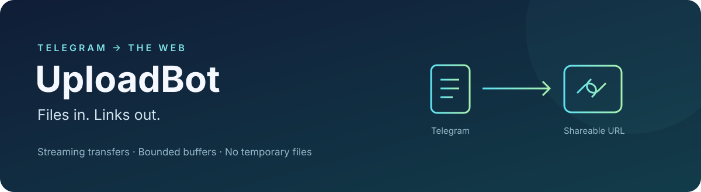

<p align="center">
  
</p>

<p align="center">
  <a href="https://github.com/IlyaKhalafi/UploadBot/actions/workflows/ci.yml"></a>
  
  <a href="LICENSE"></a>
</p>

# UploadBot

**Turn Telegram files into shareable links as they stream.** Send a document,
photo, video, or audio file to the bot and receive a download URL from your
transfer.sh-compatible server. Send a public file URL to receive it on Telegram.

```text
Telegram ── 512 KiB chunks ──► UploadBot ── HTTP PUT ──► Transfer server
                                  │
                         No temporary file
```

## Why UploadBot?

- **Start uploading immediately.** Telegram chunks feed directly into an
  asynchronous HTTP upload, without waiting for the full download.
- **Keep memory bounded.** Backpressure and a configurable concurrency limit
  keep file size from becoming buffer size.
- **Stay responsive.** Shared HTTP connections, optional native cryptography and
  uvloop, progress updates, and cancellable transfers.
- **Run it your way.** Environment configuration, an optional user allowlist,
  Docker Compose, and a configurable transfer server.

> **Bring a working transfer server.** The public `transfer.sh` endpoint was
> unreachable from the development environment during this update. Availability
> is not guaranteed. Set `TRANSFER_URL` to a working instance before testing.
> The protocol is documented by [transfer.sh](https://github.com/dutchcoders/transfer.sh).

A URL beginning with `127.0.0.1` or `localhost` opens on the machine running your
browser. If the bot returns such a link, its upload server is local to the bot's
machine. To download from a different computer, use SSH forwarding or configure
`TRANSFER_URL` with a server reachable from that computer. See
[local test downloads](docs/architecture.md#local-test-downloads).

## Quick start

Requires **Python 3.11+**, a Telegram bot token from
[@BotFather](https://t.me/BotFather), and an API ID/hash from
[my.telegram.org/apps](https://my.telegram.org/apps). The API ID/hash are also
required for bot accounts because UploadBot uses Telegram's MTProto interface.

```bash
git clone https://github.com/IlyaKhalafi/UploadBot.git
cd UploadBot
python3 -m venv .venv
source .venv/bin/activate
python -m pip install -r requirements.lock
python -m pip install --no-deps .
cp .env.example .env
# Fill in API_ID, API_HASH, BOT_TOKEN, and a working TRANSFER_URL in .env.
python main.py
```

On Windows, activate with `.venv\Scripts\activate`. The lock includes optional
speed packages; uvloop is automatically skipped on Windows. For a minimal
installation without speed extras, use `python -m pip install -r requirements.txt`.

Using [uv](https://docs.astral.sh/uv/)? Install the same locked environment with
`uv sync --locked --extra speed`, then run `uv run --no-sync python main.py`.
Startup is noninteractive and works with a service manager.

## Use it

| Send to the bot | Result |
| --- | --- |
| `/start` or `/help` | Welcome message, file limit, and commands |
| A document, photo, video, audio, voice message, or animation | Stream to the transfer server and return its URL |
| A public HTTP(S) file URL | Ask Telegram to fetch and send the file |
| `/cancel` | Stop your active transfer |

The bot operates in private chats. Each user can run one transfer at a time;
additional requests receive a busy message. Uploaded files are accessible through
their sharing URL, and their retention period depends on your transfer server.

For URL → Telegram, the URL must point to a file Telegram can fetch without login
or browser cookies. Telegram imposes its own type and size limits. Signed query
strings are preserved. The bot host does not download these URLs.

## Configuration

Copy [.env.example](.env.example) to `.env`. Existing environment variables take
precedence. Keep `.env` and Telegram session files private; both are gitignored.

| Variable | Default | Purpose |
| --- | --- | --- |
| `API_ID` | Required | Telegram application API ID |
| `API_HASH` | Required | Telegram application API hash |
| `BOT_TOKEN` | Required | Your bot's BotFather token |
| `TRANSFER_URL` | `https://transfer.sh` | Working transfer.sh-compatible base URL; HTTPS recommended |
| `MAX_FILE_SIZE` | `200000000` | Maximum Telegram → server file size, in bytes (200 MB) |
| `MAX_CONCURRENT_TRANSFERS` | `3` | Total active transfers; one per user |
| `TRANSFER_TIMEOUT` | `1800` | Per-transfer time limit in seconds |
| `ALLOWED_USER_IDS` | Empty | Comma-separated Telegram user IDs; empty permits everyone |
| `SESSION_PATH` | `data/uploadbot` | Persistent Telethon session path |

Use `ALLOWED_USER_IDS` for a personal bot. Increasing concurrency trades more
network connections and bounded per-transfer buffers for more simultaneous work.
`MAX_FILE_SIZE` applies to files received from Telegram. Telegram controls limits
when it fetches a URL directly.

## Docker

Configure `.env` first, then run the following command.

```bash
docker compose up --build -d
docker compose logs -f bot
```

The container runs as a non-root user. A named volume persists the Telegram
session, and no incoming port is required. Stop with `docker compose down`.

## Performance and reliability

The old flow downloaded a file to disk and then uploaded it using a blocking
HTTP call. The new flow removes temporary file I/O and starts the upload while
the Telegram download is still in progress. Memory remains bounded by chunks and
transport buffers rather than file size. Actual throughput depends on Telegram,
your network, and the transfer server; no universal speed multiplier is claimed.

Uploads use raw PUT requests with a known `Content-Length`. HTTP failures,
incomplete downloads, invalid response URLs, and timeouts are reported as errors.
Redirects are rejected. Configure the final upload endpoint. Interrupted uploads
are not resumed or automatically retried; resend the file when ready.

See [the architecture guide](docs/architecture.md) for flow control, cleanup, and
known limitations. Upgrading an older installation? Read the
[migration notes](CHANGELOG.md#migrating-from-1x).

## Development

```bash
uv sync --locked --extra dev --extra speed
uv run --no-sync ruff check .
uv run --no-sync ruff format --check .
uv run --no-sync pytest -q
```

Tests run offline against a local HTTP server and simulated Telegram messages.
They cover streaming before the download completes, byte integrity, bounded
Python allocations, HTTP errors, size limits, cancellation, and configuration.
CI runs on Python 3.11 through 3.14.

Read [CONTRIBUTING.md](CONTRIBUTING.md) to report a bug or contribute a fix.
If UploadBot is useful to you, a GitHub star helps other people discover it.

## License

[MIT](LICENSE).
