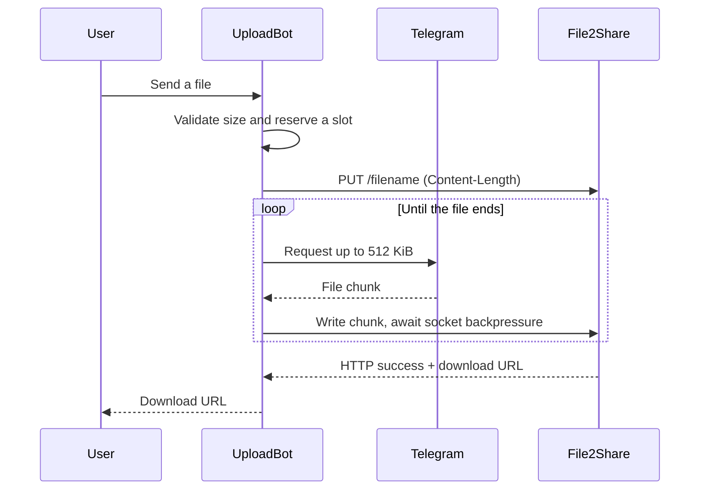

# How streaming works



`Telethon.iter_download` yields bounded chunks. An asynchronous generator passes
those chunks to `aiohttp` as a request body. HTTP flow control pauses the producer
when the destination cannot accept more data. No application-level prefetch queue
or temporary file grows with file size. Socket buffers and Telegram/HTTP internal
buffers still consume memory; this is not a zero-copy implementation.

The regression suite verifies streaming by holding back the final source chunk
until the local HTTP server confirms receiving the first one. A whole-file
buffering implementation would deadlock that test. A separate 64 MiB transfer
checks byte integrity and bounded Python allocations. These checks describe
UploadBot's client-side behaviour. They do not measure File2Share's internal
buffering or establish a universal speed improvement.

File2Share is the default upload host. Its response body contains a sharing page
URL, while the `X-Direct-Url` header identifies the actual file. UploadBot prefers
and validates that direct URL so the returned link works in a browser or a
download client. Compatible custom hosts can return a plain URL in the body.

Small files use one PUT request. Files over 95,000,000 bytes use File2Share's
numbered-part API. Each confirmed part remains on the host while a failed part
is replayed from the corresponding Telegram byte range. The default limit is
2 GB. Encryption wraps the source in independently authenticated 512 KiB frames
that can also be replayed by range. The host controls retention and rate limits.
See the [File2Share API guide](https://www.file2share.us/cli).

The transfer starts uploading before the Telegram download completes, removing
the separate disk-writing phase and allowing network operations to overlap.
Throughput is bounded by the slower connection, Telegram's request latency and
rate limits, cryptography, and the upload host. There is no guaranteed speedup.
The previous implementation already downloaded to disk rather than holding the
whole file in RAM; the main gains are eliminating disk I/O and blocking HTTP.

## Lifecycle and failures

The event handler claims a slot before its first transfer-related await. Each user
can run one transfer and the configured global limit bounds active jobs. When
full, new work is rejected immediately instead of entering an unbounded queue.
`/cancel` cancels the active handler. All exit paths release the slot, and the
Telegram iterator is explicitly closed to return its borrowed connection.

The upload request uses the declared file length and validates the actual source
byte count. Non-success HTTP status codes, invalid URL responses, oversized
response bodies, transport errors, and incomplete streams produce a failed
transfer rather than a success link. Redirects are rejected because streamed
bodies must be reopened explicitly for each attempt. Temporary failures retry
with bounded backoff, preserving confirmed numbered parts. Resume state lasts
for the running job. A server may retain a partial upload after cancellation or
a network error. See [failure handling](features.md#retries-and-progress).

Progress edits are throttled to at most once every four seconds per job. A deleted
status message or Telegram edit rate limit does not abort the file transfer.

## URLs sent to the bot

For the reverse direction, UploadBot passes a public HTTP(S) URL to Telegram's
external-media API. Telegram fetches the file directly. The bot host does not
download it, and cannot enforce `MAX_FILE_SIZE` on this path. Telegram and the
remote source decide supported file types, size limits, redirects, and access.
Authentication-required pages, private-network links, and URLs needing browser
cookies generally do not work. URL queries are preserved and suffix detection
uses only the path.

## Local test downloads

A receiver bound to `127.0.0.1` accepts connections only from its own machine.
The bot can upload to it, but a returned loopback URL will not open directly on a
different computer. A successful upload reply labels private-network links.

If your test server uses port `36579`, forward that port from your computer.
Replace `your-server` with the host or SSH alias you use to connect to the bot's
machine.

```bash
ssh -N -L 36579:127.0.0.1:36579 your-server
```

Keep that connection open, then open the returned `http://127.0.0.1:36579/...`
URL in your browser. Substitute the receiver's actual port in both places if it
differs. The receiver must remain running for the download to work.

Normal operation uses File2Share and returns public URLs that need no SSH
forwarding. Loopback links appear only if an operator deliberately configures a
local upload receiver. Changing the hostname in a returned URL does not make a
loopback-bound receiver publicly reachable.

## Configuration and sessions

Environment variables override `.env` in the working directory. No secrets belong
in source files. A persistent Telethon session is stored separately from uploaded
files; protect it like the bot token. On shutdown the Telegram client disconnects
before the shared HTTP session closes. Uploaded file bytes never enter the
session file.
